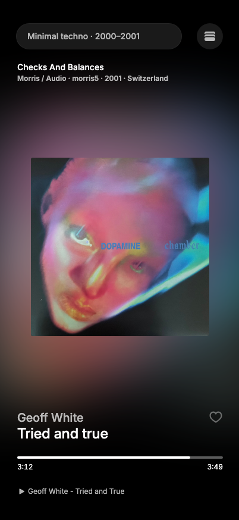
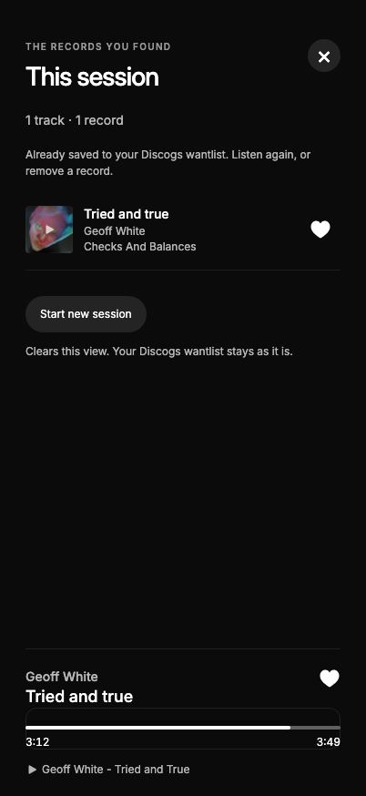
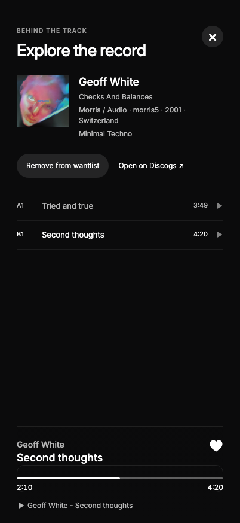

# Crate Swipe

A little digging. A great discovery.

Swipe through vinyl releases, listen to linked YouTube tracks and keep your guest finds without setup. Add your own Discogs token later to save those records to your wantlist. Reopen **This session** to listen to your finds again or remove a record. The session stays on this browser until you start a new one.

<p>
  
  
  
</p>

## Run locally

Use Node.js 24 or newer. No dependencies or build step are needed to serve the app:

```sh
node scripts/serve.mjs
```

Open [the local app](http://127.0.0.1:4173/). Guest discovery uses the public throwaway account configured in `config.js`; no signup or backend is required. You can also connect with your own Discogs personal access token. Your personal token stays in localStorage on that browser/origin and is sent only to Discogs. Never commit personal tokens or put them in URLs.

For a deterministic, credential-free local demo, open [the local demo](http://127.0.0.1:4173/?fixture=1). It uses simulated players and Discogs responses; it does not make external requests or play real audio. This mode is disabled on public hosts.

## How it works

- Choose a genre/style, year range, label or country. Only vinyl releases and videos already linked on Discogs are included.
- Swipe vertically or use ↑/↓. Tap artwork to pause/play; the first tap enables sound. Scrub to seek.
- As a guest, hearts save individual finds on this browser. Shared-account copies are best effort; removing a guest find never removes a shared want.
- Add your own token from **This session** to merge your guest finds into your own wantlist. Failed saves stay available for retry.
- When connected, hearts add/remove the **record** on your Discogs wantlist immediately.
- The stacked-records button opens **This session**: tracks you explicitly liked in this session, with replay and removal controls. It is not a checkout and does not show your entire historic wantlist.
- Discogs saves releases, not individual tracks. Removing a record also removes session tracks linked to that wanted version. Other wanted pressings are retained.
- Session replay has its own playback position/order. Closing it returns to the discovery track and position you left.
- Tap the release metadata to see its tracklist and Discogs link.
- **Start new session** clears the local discoveries view only. Filters and reloads do not clear it, and your remote wantlist is unaffected.
- Keyboard: Space pause/play, L toggle wanted record, E release details, M mute. Escape closes a panel; Tab stays inside it.

## Files

| File | Responsibility |
| --- | --- |
| `index.html` | Accessible page shell, forms and panels |
| `styles.css` | Figma-derived layout, responsive rules and Inter typography |
| `app.js` | UI, feed, shared players, seek controls and authentication |
| `core.js` | Original v2.3 discovery, matching, rate-limited API and cache integration |
| `session.js` | Persistent guest/account discoveries and resumable wantlist import |
| `catalogue-client.js`, `config.js` | Public throwaway account client and shared-token configuration |
| `assets/` | Local Figma SVG exports and Inter webfont/license |
| `tests/` | Unit tests, localhost fixture and browser acceptance suite |

Existing `dx_token`, `dx_user`, `dx_opts`, `dx_seen`, `dx_stats` and the IndexedDB release cache remain compatible. New session/remote-state caches are scoped by Discogs username. A complete wantlist refresh is required before mutation controls are enabled; failed reads are shown as unknown, rather than an empty wantlist.

## Test

Syntax and logic checks need no installed dependencies:

```sh
node --check app.js
node --check core.js
node --check session.js
node --test tests/*.test.js
```

For browser checks, install the pinned development dependency with pnpm, then its browsers:

```sh
pnpm install --frozen-lockfile
pnpm exec playwright install chromium webkit
```

Keep the local server running in another terminal:

```sh
pnpm test:browser
BROWSER=webkit pnpm test:browser
```

On macOS, you can use an existing Chrome installation instead of downloading Chromium:

```sh
CHROME_PATH="/Applications/Google Chrome.app/Contents/MacOS/Google Chrome" pnpm test:browser
```

The browser suite blocks external requests, uses fake wantlist writes and saves screenshots and a JSON report in ignored `test-results/`. WebKit output lives in `test-results/webkit/`. Use `PORT` for the local server and `BASE_URL` for browser checks if another local port is needed.

## Publish on GitHub Pages

This is a static site again, including guest mode. Push the source files to the existing repository and serve its root from the chosen Pages branch. No backend, hosting account, environment secrets or build output are required. Keep `.nojekyll`.

Include the JavaScript/CSS files, `index.html` and `assets/`. Relative paths work under `/crate-swipe/`. See [guest deployment notes](docs/guest-deployment.md).

The throwaway token in `config.js` is intentionally public with the owner's approval. Anyone can extract and use it; it is not a restricted or private credential. Personal tokens entered by visitors remain browser-local and are never copied into this file. Do not upload `.env` files, `node_modules`, `.browsers` or test output.

See [guest verification](docs/guest-verification.md) and [implementation notes](docs/implementation-notes.md) for validation scope and remaining live-device checks.

## Design and credits

Playback layout: [Crate Figma reference](https://www.figma.com/design/WLaSHMeVF4am22j71aRoPH/Crate?node-id=1-8). Inter is used throughout as agreed; the design's Aeonik headings are intentionally substituted. SVGs are local exports from the supplied Figma file. The artwork under `tests/` is the supplied reference image for visual testing; production artwork comes from Discogs.

Inter is bundled under its SIL Open Font License, included in `assets/fonts/OFL.txt`. No project-wide license has been added to the upstream repository.
